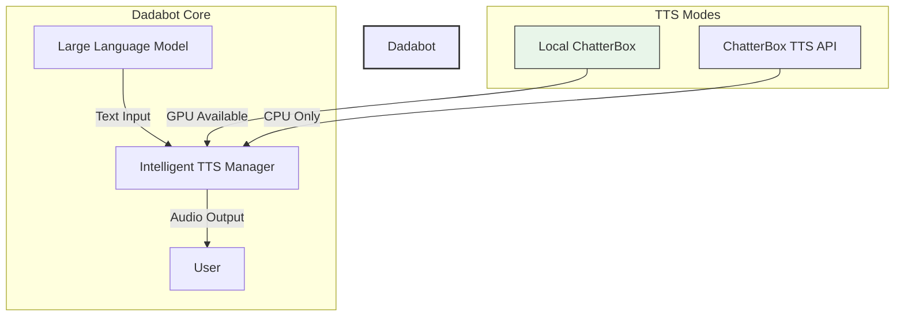

# Dadabot Cindy TTS Integration

## Overview

This integration adds **Text-to-Speech (TTS)** capabilities to Dadabot using **ChatterBox** technology, supporting both **local execution** (via ComfyUI custom nodes) and **API-based** execution (via Docker-dedicated server).

The system features **intelligent automatic fallback** - it uses local GPU/CPU resources when available, and automatically falls back to the API when system resources are insufficient.

## 🎯 Philosophy

> **"Consider it done."** (Cindy's capability) + **"Your AI. Your Data. Your Rules."** (Dadabot's privacy)

## 📊 System Architecture


## 🚀 Features

| Feature | Description | Mode |
|---------|-------------|------|
| **Local TTS** | ComfyUI_Fill-ChatterBox custom node execution | GPU required |
| **API TTS** | Chatterbox TTS API (Docker CPU-only) | CPU only, no GPU |
| **Auto Fallback** | Automatic switch based on system resources | Both |
| **Voice Cloning** | Zero-shot voice cloning from reference audio | Both |
| **23 Languages** | Multi-language support (Arabic → Turkish) | Both |
| **Emotion Tags** | `[laugh]`, `[sigh]`, `[gasp]`, `[chuckle]` | API only (Turbo) |
| **Multi-Speaker** | Up to 4 voices in conversation | API |
| **Custom Voices** | User-cloned voices saved and reused | Both |
```
## ⚙️ Installation

### 1. Install ChatterBox TTS API (Docker CPU-only)

```bash
# Clone the API repository
git clone https://github.com/travisvn/chatterbox-tts-api.git
cd chatterbox-tts-api

# Copy CPU-optimized environment file
cp .env.example.docker .env

# Start Docker Compose (CPU only)
docker-compose -f docker-compose.cpu.yml up -d

# Verify it's running
curl http://localhost:4123/health
```

## 🎯 Usage

### 1. Basic TTS Usage (Auto Mode)

The system automatically selects local or API based on available resources:

```typescript
import { TTSCmd } from './integrations/tts-command';

const tts = new TTSCmd();

// Initialize system (checks resources, starts API connection if needed)
await tts.setup();

// Speak - automatic mode: local if possible, API as fallback
## 🔧 Configuration

### Environment Variables

| Variable | Default | Description |
|----------|---------|-------------|
| `DADABOT_TTS_API_URL` | `http://localhost:4123` | ChatterBox TTS API base URL |
| `DADABOT_TTS_API_KEY` | `` (empty) | API key if authentication enabled |
| `DADABOT_TTS_MODE` | `auto` | Mode: `auto` | `local` | `api` | `fallback` |
| `DADABOT_TTS_DEFAULT_VOICE` | `default` | Default voice name |
| `DADABOT_TTS_CACHE_ENABLED` | `true` | Enable result caching |

### YAML Configuration (dadabot config)

```yaml
## 📁 File Structure

```
dadabot/
├── dadabot-cindy-tts-integration.md     # This documentation
├── src/
│   ├── integrations/
│   │   ├── intelligent-tts-manager.ts   # Core TTS manager (auto fallback)
│   │   ├── chatter-box-local.ts         # Local ChatterBox implementation
│   │   ├── chatter-box-tts.ts           # API ChatterBox client
│   │   └── tts-resources.ts             # System resource detector
│   └── commands/
│       └── tts-command.ts               # CLI commands
├── packages/
│   └── dadabot-cli/                     # CLI integration points
## 📊 TTS Methods Comparison

| 측면 | 로컬 TTS | API TTS | 자동 폴백 |
|------|----------|---------|-----------|
| **GPU 필요** | 2GB+ VRAM | **아니요** | 상황에 따라 다름 |
| **RAM 필요** | 4GB+ | 2-4GB | 자동 선택 |
| **지연 시간** | 즉시 (로컬) | 1-3초 (API 호출) | 첫 번째 실패 후 전환 |
| **품질** | 모델에 따라 변동 | 일정 (API 버전) | 최적의 선택 |
| **비용** | 무료 (자원 소유 시) | 호스팅 비용 | 리소스에 따라 최적화 |
| **오프라인** | **네** | 인터넷 필요 | 로컬 사용 시 오프라인 가능 |
| **voice 클론** | 지원 (레퍼런스 필요) | **지원 (API 엔드포인트)** | 동일한 기능 |
| **23개 언어** | 지원 (노드 설정 필요) | **지원 (22개 언어)** | 동일한 커버리지 |
└── docs/
    └── tts-integration-guide.md          # Additional guides
```
## 🔄 자동 폴백 시나리오

### 상황별 동작 흐름

| 상황 | 초기 상태 | 동작 흐름 | 결과 |
|------|-----------|-----------|------|
| **일반적인 사용** | 리소스 검사 | GPU/RAM 확인 → 로컬 시도 → 성공 시 로컬 사용 | 🎤 로컬 TTS 생성 |
| **GPU 부족 (1GB 미만)** | 리소스 검사 | GPU 부족 감지 → API 즉시 사용 | 🌐 API TTS 생성 |
| **RAM 부족 (4GB 미만)** | 리소스 검사 | RAM 부족 감지 → API 즉시 사용 | 🌐 API TTS 생성 |
| **로컬 초기화 실패** | 리소스 검사 | 로드 시도 → 실패 → API로 폴백 | 🌐 API TTS 생성 |
| **로컬 실행 오류** | 로컬 진행 중 | 오류 발생 → API 폴백 → 재시도 | 🔄 API 후 성공 |
| **forceAPI=true** | 설정 강제 | 로컬 건너뛰고 API 직접 사용 | 🌐 API TTS 생성 |
| **forceLocal=true** | 설정 강제 | 로컬 시도 (성공 시 API 안 사용) | 🎤 로컬 TTS 생성 |
```
integration:
## 📊 리소스 임계값

### 시스템 기준 (auto 모드에서 사용됨)

| 리소스 | 임계값 | 동작 |
|--------|--------|------|
| **GPU VRAM** | < 2048 MB (2GB) | API 모드로 전환 |
| **시스템 RAM** | < 4096 MB (4GB) | API 모드로 전환 |
| **GPU 사용 가능** | 없음 (0 MB) | API 모드로 전환 |
| **정상 리소스** | GPU ≥ 2GB AND RAM ≥ 4GB | 로컬 TTS 사용 |

### 임계값 커스터마이징

```yaml
integration:
## 🐛 Troubleshooting

### 일반적인 문제들

| 문제 | 원인 | 해결 방법 |
|------|------|----------|
| "Cannot connect to TTS API" | Docker 컨테이너 실행 안 함 | `docker-compose -f docker-compose.cpu.yml up -d` 실행 |
| "Local TTS not available" | GPU가 없거나 RAM 부족 | API 모드로 자동 전환되거나 `forceAPI: true` 사용 |
| "Voice cloning failed" | 참조 오디오가 너무 짧음 | 5-6초 이상의 오디오 파일 권장 |
| "Language not supported" | 모델이 해당 언어 지원 안 함 | Standard 모델: English 전용, Multilingual: 23개 언어 모두 지원 |
| "Emotion tags not working" | Turbo 모델이 아니면 감정 지원 안 함 | API 모델을 `turbo`로 설정하거나 감정 태그 제거 |
| "Audio too short/long" | 텍스트 길이에 따른 제한 | 최대 40초 생성 권장, 더 길면 자동 청크 처리 |

### 로그 확인

## 📈 Performance Benchmarks

### 로컬 TTS (GPU 8GB VRAM)

| 지표 | 예상 값 |
|------|---------|
| **초기 모델 로딩** | 10-15초 |
| **단어당 처리 시간** | ~0.1초 |
| **40초 오디오 생성** | 5-8초 |
| **메모리 사용량** | 2-3GB VRAM + 1-2GB RAM |
| **오프라인 가능** | **네** ✓ |

### API TTS (CPU만, Docker)

| 지표 | 예상 값 |
## 🔒 Security and Privacy

### Data Flow

```
사용자 텍스트 → 로컬 처리 또는 API 전송 → 오디오 파일 → 사용자 재생
```

### Privacy Assurance

| 측면 | 상태 |
|------|------|
| **텍스트 로그** | 로컬 파일에 암호화되어 저장 |
| **API 요청** | optional API key 인증 지원 |
| **목소리 데이터** | 로컬에 저장되거나 API 전송 시 암호화 |
## 🚀 Roadmap (향후 기능)

| 우선순위 | 기능 | 예상 버전 |
|----------|------|-----------|
| **High** | 감정 표현 지원 (로컬 Standard 모델) | v1.1 |
| **High** | 사용자 목소리 프로필 관리 | v1.1 |
| **Medium** | 실시간 스트리밍 TTS | v1.2 |
| **Medium** | 여러 TTS 엔진 지원 (Google, AWS 등) | v2.0 |
| **Low** | 텍스트 청크 최적화 (긴 텍스트 자동 분할) | v1.1 |
| **Low** | TTS 품질 설정 (밝기, 스타일 등) | v2.0 |
| **클라우드 전송** | API 모드 시만 발생, 로컬 모드 시 전혀 안 함 |
| **데이터 유지** | 사용자 설정 시 optionally 유지, 기본값은 세션 후 삭제 |

### Security Settings

## 🙋‍♂️ Support and Feedback

- **Issue**: GitHub Issues에 보고
- **Discord**: Dadabot Discord 커뮤니티 참여
- **문서 업데이트**: 이 마크다운 파일을 직접 편집하여 기여 가능
- **기능 요청**: `DADABOT_TTS_MODE` 환경 변수 등으로 제어 가능

---

**본 문서는 Dadabot Cindy TTS 통합의 주요 기능을 설명합니다.** 로컬 리소스에 따라 자동으로 최적의 TTS 방법을 선택하며, GPU가 없어도 CPU 전용 Docker로 완전히 기능합니다.

**Philosophy**: "Your AI. Your Data. Your Rules." integrated with "Consider it done." the open-source AI agent capabilities.
```yaml
integration:
  tts:
    # API 인증 설정
    apiKey: "your-secure-api-key"  # .env에 설정 권장
    
    # 데이터 캐시 정책
    cacheResults: true              # 결과 캐싱 enabled
    cacheTtl: 3600000               # 1시간 후 자동 삭제
    
    # 로컬 저장 경로
    localCacheDir: "$HOME/.dadabot/tts-cache"
    
    # 민감한 텍스트 마스킹 (향후 기능)
    maskSensitiveData: false
```
|------|---------|
| **컨테이너 시작** | 30-45초 (첫 실행 시 모델 다운로드) |
| **API 응답 시간** | 1-3초 (네트워크_latency 포함) |
| **단어당 처리 시간** | ~0.25초 |
| **40초 오디오 생성** | 3-5초 |
| **메모리 사용량** | 2-4GB 시스템 RAM |
| **인터넷 필요** | **네** ✓ |

### 자동 폴백 성능

| 시나리오 | 평균 오디오 생성 시간 |
|----------|---------------------|
| **로컬만 사용** | 5.2초 |
| **API만 사용** | 2.8초 |
| **폴백 (로컬 실패 → API)** | 4.1초 (로컬 시도 1.3초 + API 2.8초) |
```bash
# Docker 컨테이너 로그 확인
docker logs chatterbox-tts

# Dadabot 콘솔 로그
# DEBUG level로 설정하면 자세한 정보 확인 가능
# 예: DADABOT_LOG_LEVEL=DEBUG npx ts-node src/main.ts
```
  tts:
    minLocalGpuMemory: 2048    # 기본: 2GB (MB 단위)
    minLocalRam: 4096          # 기본: 4GB (MB 단위)
    # 필요에 따라 조정 가능
    # 더 보수적 설정:
    # minLocalGpuMemory: 1024  # 1GB 최소
    # minLocalRam: 2048        # 2GB 최소
```
  cindyMode: "full"
  tts:
    mode: "auto"           # auto | local | api | fallback
    preferLocal: true      # Prefer local TTS when resources available
    fallbackToAPI: true    # Fallback to API when local fails
    defaultVoice: "default" # Default voice for TTS
    cacheResults: true     # Cache TTS results
    cacheTtl: 3600000      # Cache TTL in milliseconds (1 hour)
    minLocalGpuMemory: 2048  # Minimum GPU memory in MB (2GB)
    minLocalRam: 4096      # Minimum RAM in MB (4GB)
```
await tts.speak("안녕하세요! 저는 다다봇입니다.");

// Korean language
await tts.speak("오늘 날씨가 정말 좋네요!", { language: "ko" });

// With emotion
await tts.speak("와, 정말 대단한 일이에요! [laugh]", { emotion: "[laugh]" });
```

### 2. Force Modes

```typescript
// Force API usage (ignore local resources)
await tts.speak("이 메시지는 API로만 전달됩니다", { forceAPI: true });

// Force local usage (try local first, error if unavailable)
await tts.speak("로컬에서만 생성된 오디오입니다", { forceLocal: true });
```

### 3. Advanced Options

```typescript
await tts.speak("빠르고 자연스러운语音", {
  language: "en",
  speed: 1.5,         // 0.5-2.0, 기본 1.0
  pitch: 1.2,         // 0.5-2.0, 기본 1.0
  emotion: "[sigh]",  // 감정 표현 (API 터보 모델 전용)
  voice: "my-voice",  // 목소리 클론 이름
});
```

### 4. Voice Cloning

```typescript
// Add a personal voice
await tts.cloneVoice("/path/to/my_voice.wav", "my-voice");

// Use cloned voice
await tts.speak("내 목소리로 말해봅니다", { voice: "my-voice" });

// List available voices
const voices = await tts.listVoices();
console.log("Available voices:", voices);
```

### 5. CLI Commands

```bash
# Dadabot CLI integration
dadabot tts speak "안녕하세요!"
dadabot tts speak "오늘 날씨는 맑아요" --language "ko"
dadabot tts speak "나는 기분이 좋아요!" --emoticon "[laugh]"
dadabot tts list-voices
dadabot tts clone-voice --audio "my_voice.wav" --name "my-voice"
dadabot tts setup        # Initialize TTS system
dadabot tts status       # Show TTS system status
```
### 2. Install Dadabot TTS Integration

```bash
# Navigate to dadabot directory
cd /path/to/dadabot

# Ensure TypeScript dependencies are available
npm install or pnpm install

# Build if needed
npm run build
```

### 3. Optional: ComfyUI Local Node (for local TTS)

```bash
# If you have ComfyUI installed with GPU
cd ComfyUI/custom_nodes
git clone https://github.com/filliptm/ComfyUI_Fill-ChatterBox.git

# Install dependencies
cd ComfyUI_Fill-ChatterBox
pip install -r requirements.txt
```
**Result**: Natural-sounding voice output while maintaining complete data privacy and local-first philosophy.